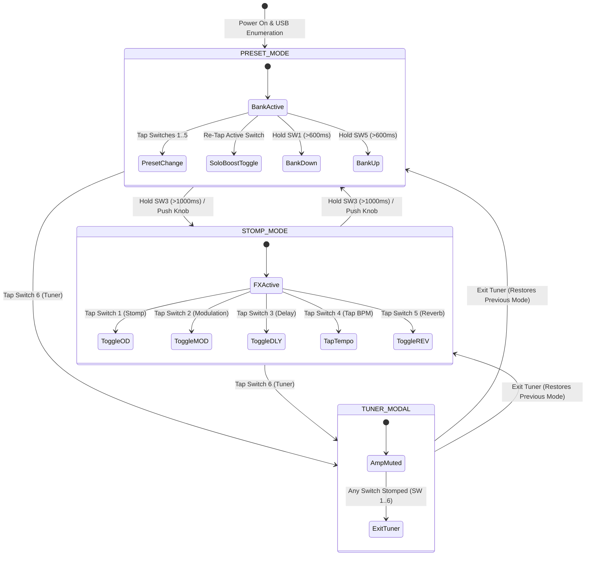

# Fender Mustang LT25 Smart Footswitch Controller

[](LICENSE)
[](https://www.raspberrypi.com/)
[](docs/PROTOCOL_REVERSE_ENGINEERING.md)
[](docs/INSTALLATION_AND_OVERLAYFS.md)

An open-source, concert-grade, 6-button intelligent footswitch controller and stage telemetry display for the **Fender Mustang LT25** digital modeling guitar amplifier.

---

## The Problem & The Solution

The **Fender Mustang LT25** is one of the most popular practice and studio modeling amplifiers in the world, featuring 60 versatile presets, realistic amp models, and onboard digital effects. However, for live stage performance, it suffers from two major limitations:

1. **No MIDI Connectivity:** The amplifier completely lacks traditional 5-pin DIN MIDI or USB-MIDI class support.
2. **Severely Limited Footswitching:** The physical rear footswitch jack accepts only a basic 1-button latching switch that toggles between two pre-assigned Quick-Access presets. Switching to any of the other 58 presets during a gig requires crouching down, squinting at the miniature top-panel screen, and manually turning the master rotary knob on top of the amplifier.

### The Solution: The Smart Footswitch Controller
This project turns the Fender Mustang LT25 into a concert-ready performance rig by interfacing directly with the amplifier's internal DSP over **reverse-engineered USB HID interrupt transfers**. Hosted on a compact, embedded **Raspberry Pi Zero 2 W**, this pedal transforms preset recall, individual effect bypass, solo volume boosting, and chromatic tuning into a zero-latency, tactile stage pedalboard experience.

---

## Flagship Features

* **60 Presets across 12 Banks:** Instant, single-stomp recall of presets 1–5 in the active bank, with fast hold-to-cycle bank navigation (12 banks total).
* **Colossal 64pt OLED Stage Display:** High-contrast 1.3" I2C display showcasing a massive 64-point preset number and dynamic two-line preset title, effortlessly readable from standing height under blinding stage lights.
* **WS2812B NeoPixel Telemetry:** 6 individually addressable RGB LEDs providing vivid, color-coded stage feedback (Emerald Green, Fiery Red, Amber, Cyan, and Dim Standby).
* **True +3.0 dB DSP Solo Boost:** Pressing the active preset switch a second time immediately injects a clean +3.0 dB volume boost directly into the amplifier's internal DSP `amp` volume node, accompanied by a high-visibility full-screen OLED video inversion.
* **Stompbox FX Mode with Live Tap Tempo:** Toggle into STOMP mode to independently bypass and engage individual effects blocks (`stomp` Overdrive, `mod` Chorus/Phaser, `delay`, `reverb`). Footswitch 4 functions as an interactive live Tap Tempo calculator.
* **Dedicated Upper-Deck Tuner / Mute with "Any-Key Exit":** An elevated top-right footswitch engages the amplifier's internal chromatic tuner and mutes audio output. Stomping **ANY footswitch** instantly exits tuner mode, restores audio in under 47ms, and returns to the active preset without changing slots.
* **Hardware Rotary Encoder Navigation:** Seamlessly spin through all 60 presets with immediate DSP synchronization and title preview at your desk or pedalboard; push the knob to switch modes.
* **Galvanic USB Audio Isolation:** An onboard ADuM3160 digital isolator breaks ground loops between the amplifier and pedal power, eliminating 50/60 Hz hum and digital CPU noise.
* **Cold-Pull Power Resilience (OverlayFS):** Stage-hardened read-only Linux root filesystem allows the 9V pedalboard power cord to be pulled abruptly at the end of a gig with zero risk of MicroSD card corruption.

---

## Physical Enclosure & Hardware Layout

The enclosure features a two-tier stepped ergonomic design with a 12.88° rake angle. The OLED display, rotary encoder, and Tuner/Mute footswitch reside on the elevated upper deck, physically preventing accidental foot strikes during aggressive performance.

```text
+----------------------------------------------------------------------------------------------------+
|  [9V DC] [USB-C 5V]                                                          [RECESSED USB HOST]   |
|                                                                                                    |
|                       +-----------------+   (KNOB)                                  (O)  SWITCH 6  |
|                       |  1.3" OLED      |   Rotary                               [MUTE / TUNER]    |
|                       |  (128x64 I2C)   |   Encoder                                 *    (LED 6)   |
|                       +-----------------+                                                          |
|                                                                                                    |
|           (LED 1)           (LED 2)           (LED 3)           (LED 4)           (LED 5)          |
|              *                 *                 *                 *                 *             |
|                                                                                                    |
|             (O)               (O)               (O)               (O)               (O)            |
|           SWITCH 1          SWITCH 2          SWITCH 3          SWITCH 4          SWITCH 5         |
|          [PRESET 1]        [PRESET 2]        [PRESET 3]        [PRESET 4]        [PRESET 5]        |
|          [BANK -]                           [MODE/STOMP]                         [BANK +]          |
+----------------------------------------------------------------------------------------------------+
|  FRONT HEIGHT: 32mm                                                             REAR HEIGHT: 48mm  |
|                                    <--- 12.88° ERGONOMIC SLANT --->                                |
+----------------------------------------------------------------------------------------------------+
```

---

## Hardware Wiring Block Diagram

```text
  [ 9V DC IN ] (Pedalboard Power Supply, 2.1mm Center-Negative)
       |
      [+] Outer Sleeve ----> [ 1N5822 Schottky Diode ] ----> MP1584EN Buck IN+
      [-] Center Pin --------------------------------------> MP1584EN Buck IN- & Common Star GND
                                                                    |
                                                            [ MP1584EN BUCK ]
                                                          (Calibrated to 5.20V DC)
                                                                    |
                                                                 OUT+ (5.20V)
                                                                    |
                                                           [ RXEF110 1.1A Polyfuse ]
                                                                    |
    +---------------------------------------------------------------+-------------------------------+
    |                                                               |                               |
    v                                                               v                               v
  Raspberry Pi Zero 2 W                                   SN74HCT125N Buffer             WS2812B RGB LEDs
  +-------------------------------------------------+     +-----------------------+      +-------------------+
  | Pin 02 (+5V Bus) <------------------------------+     | Pin 14 (VCC) <--------+      | +5V Rail <--------+
  | Pin 06 (Star GND) <-------------------+         |     | Pin 07 (GND) <---+    |      | GND Bus <---+     |
  |                                       |         |     | Pin 01 (1OE) <---+    |      +-------------|-----+
  | Pin 01 (+3.3V) ----> OLED VCC         |         |     |                       |                    |
  | Pin 09 (GND)   ----> OLED GND         |         |     | Pin 02 (1A) <---------+                    |
  | Pin 03 (SDA)   ----> OLED SDA         |         |     | Pin 03 (1Y) ---+                           |
  | Pin 05 (SCL)   ----> OLED SCL         |         |     +----------------|------+                    |
  |                                       |         |                      |                           |
  | Pin 17 (+3.3V) ----> KY-040 VCC (3.3V)|         |            [ 470R Resistor ]                     |
  | Pin 20 (GND)   ----> KY-040 GND       |         |                      |                           |
  | Pin 18 (GPIO 24) <-- KY-040 CLK       |         |                      +-----> DIN (LED 1..6)      |
  | Pin 22 (GPIO 25) <-- KY-040 DT        |         |                                                  |
  | Pin 32 (GPIO 12) <-- KY-040 SW (Push) |         |                                                  |
  |                                       |         |                                                  |
  | Pin 12 (GPIO 18 / PWM0) --------------+---------+                                                  |
  |                                       |                                                            |
  | Pin 11 (GPIO 17) <-- Switch 1         |                                                            |
  | Pin 13 (GPIO 27) <-- Switch 2         |                                                            |
  | Pin 15 (GPIO 22) <-- Switch 3         |                                                            |
  | Pin 16 (GPIO 23) <-- Switch 4         |                                                            |
  | Pin 29 (GPIO 05) <-- Switch 5         |                                                            |
  | Pin 31 (GPIO 06) <-- Switch 6 (Tuner) |                                                            |
  | Pin 30 (GND)   ----> Footswitch GND --+------------------------------------------------------------+
  |                                       |
  | USB OTG Port -----------------------+ |
  +-------------------------------------|-+
                                        v
                            [ ADuM3160 USB Isolator ]
                                        |
                             [ Panel-Mount USB-A ]
                                        |
                          [ Fender Mustang LT25 Micro-USB ]
```

---

## State Machine & Switching Flow



---

## Hardware Bill of Materials (BOM) & Sourcing

Every component is standard off-the-shelf maker hardware. Total build cost is approximately **$35 – $45 USD** (~€35 – €45 EUR / ~70 – 85 BGN).

| Category | Component Description | Specifications / Model | Quantity | Approx. Cost | Direct Sources |
| :--- | :--- | :--- | :---: | :---: | :--- |
| **SBC Host** | Raspberry Pi Zero 2 W | Quad-core 64-bit BCM2710A1, Wi-Fi, BT | 1 | ~$18.00 / €19.00 | [BerryBase](https://www.berrybase.de/) / [Comet](https://store.comet.bg/) / [Botland](https://botland.store/) |
| **Footswitches** | SPST Momentary Soft-Touch Pushbuttons | PBS-24-102 clickless, 12mm panel mount | 6 | ~$8.00 / €7.50 | AliExpress Choice / Amazon |
| **Display** | 1.3" I2C Monochrome OLED Screen | SH1106 / SSD1306, 128×64, 4-pin I2C | 1 | ~$3.50 / €3.00 | AliExpress Choice / Adafruit |
| **Rotary Encoder** | KY-040 Quadrature Encoder + Knob | 20 detents/rev, knurled 6mm aluminum cap | 1 | ~$2.00 / €1.80 | AliExpress Choice |
| **Power Converter** | MP1584EN Step-Down DC-DC Buck | 9V $\to$ 5.20V DC, 3A rated, miniature | 1 | ~$1.20 / €1.00 | AliExpress Choice / Ardboard |
| **Lighting** | WS2812B 5050 Addressable RGB Strip | Trimmed to 6 individual pixels | 6 LEDs | ~$2.50 / €2.00 | AliExpress Choice |
| **Level Shifter** | SN74HCT125N / 74AHCT125 Quad Buffer | DIP-14, 3.3V to 5.0V TTL-level translation | 1 | ~$0.60 / €0.50 | TI / Mouser / Comet #44148 |
| **Protection** | RXEF110 PTC Resettable Polyfuse | $I_H = 1.1\text{A}$, $I_T = 2.2\text{A}$, 72V radial | 1 | ~$0.30 / €0.25 | Littelfuse / Comet #15283 |
| **Polarity Diode** | 1N5822 Schottky Barrier Diode | 3A 40V, low $V_F \approx 0.28\text{V}$, DO-27 | 1 | ~$0.20 / €0.15 | Mouser / Comet #15121 |
| **Decoupling Caps** | 220µF 25V Electrolytic + 100nF Box Cap | Low-ESR bulk + film bypass | 1 ea | ~$0.50 / €0.40 | Nichicon / WIMA / Comet |
| **USB Isolator** | ADuM3160 Full-Speed USB Digital Isolator | 2500V galvanic isolation + B0505S 5V | 1 | ~$5.00 / €4.50 | AliExpress Choice |
| **Hardware / 3D** | Custom 3D Enclosure & M3 Fasteners | PETG-CF, 4x M3 heat-set inserts, feet | 1 kit | ~$4.00 / €3.50 | Bambu Lab / Local print |

For complete European catalog numbers, direct vendor hyperlinks, and local store breakdowns, refer to [`BUILD_GUIDE.md`](BUILD_GUIDE.md).

---

## Quickstart & Installation

```bash
# 1. Update OS and install system libraries
sudo apt update && sudo apt install -y git python3-pip python3-dev libhidapi-dev libusb-1.0-0-dev i2c-tools overlayroot

# 2. Install hardware abstraction Python libraries
sudo pip3 install --break-system-packages hidapi protobuf RPi.GPIO adafruit-circuitpython-ssd1306 luma.oled pillow rpi_ws281x

# 3. Setup USB udev permissions for Fender Mustang LT25
sudo bash -c 'cat << EOF > /etc/udev/rules.d/99-fender-lt25.rules
SUBSYSTEM=="usb", ATTRS{idVendor}=="1ed8", ATTRS{idProduct}=="0037", MODE="0666"
KERNEL=="hidraw*", ATTRS{idVendor}=="1ed8", ATTRS{idProduct}=="0037", MODE="0666"
EOF'
sudo udevadm control --reload-rules && sudo udevadm trigger

# 4. Clone repository and install systemd auto-start daemon
cd /home/pi
git clone https://github.com/user/fender-mustang-lt25-smart-pedal.git .
sudo cp systemd/lt25-pedal.service /etc/systemd/system/lt25-pedal.service
sudo systemctl daemon-reload
sudo systemctl enable --now lt25-pedal.service

# 5. Enable read-only OverlayFS for cold-pull stage power resilience
sudo sed -i 's/overlayroot=""/overlayroot="tmpfs"/' /etc/overlayroot.conf
sudo reboot
```

For exhaustive, step-by-step instructions, see [`docs/INSTALLATION_AND_OVERLAYFS.md`](docs/INSTALLATION_AND_OVERLAYFS.md).

---

## Documentation Index

Comprehensive engineering manuals are available in the repository:

1. **[`BUILD_GUIDE.md`](BUILD_GUIDE.md):** Physical assembly manual, mechanical fabrication, step-by-step soldering checklist, and no-short safety protocols.
2. **[`docs/HARDWARE_SCHEMATIC.md`](docs/HARDWARE_SCHEMATIC.md):** Complete schematic documentation, 40-pin GPIO pinout table, level-shifting analysis, and current budget engineering.
3. **[`docs/PROTOCOL_REVERSE_ENGINEERING.md`](docs/PROTOCOL_REVERSE_ENGINEERING.md):** Exhaustive technical guide to the Fender Mustang LT25 USB HID protocol, protobuf framing, modal handshake rules, and DSP parameter injection.
4. **[`docs/SOFTWARE_ARCHITECTURE.md`](docs/SOFTWARE_ARCHITECTURE.md):** Daemon architecture, multithreading synchronization, 40ms refractory debouncing algorithm, and OLED typography layout algorithms.
5. **[`docs/INSTALLATION_AND_OVERLAYFS.md`](docs/INSTALLATION_AND_OVERLAYFS.md):** Linux provisioning, dependency deployment, systemd configuration, and OverlayFS read-only maintenance workflows.

---

## Repository Structure

```text
├── BUILD_GUIDE.md                     # Master physical build, wiring, and assembly guide
├── README.md                          # Primary project documentation & architecture overview
├── TODO.md                            # Hardware/firmware progress log & reverse-engineering lessons
├── LICENSE                            # MIT Open Source License
├── pedal_enclosure.scad               # Parametric OpenSCAD 3D enclosure model
├── pedal_top_shell.stl                # Watertight top shell STL with heavy stomp pillars
├── pedal_baseplate.stl                # Watertight baseplate STL with component cradles
├── lt25_smart_pedal.py                # Complete production controller daemon implementation
├── ltamp/                             # Reverse-engineered Fender Mustang LT25 USB HID driver & protobufs
├── docs/
│   ├── HARDWARE_SCHEMATIC.md          # Schematics, GPIO pinouts, level shifter & power design
│   ├── PROTOCOL_REVERSE_ENGINEERING.md# USB HID packets, Protobuf catalog & modal sync rules
│   ├── SOFTWARE_ARCHITECTURE.md       # Multithreading, debouncing, OLED layout & LED engines
│   └── INSTALLATION_AND_OVERLAYFS.md  # OS setup, systemd daemon & OverlayFS stage hardening
├── systemd/
│   └── lt25-pedal.service             # Production systemd daemon unit file
├── diagnostics/                       # Interactive hardware testing and protocol diagnostics
└── assets/                            # Stage screen renders and visual assets
```

---

## License

This project is licensed under the **MIT License** — feel free to modify, build, and adapt it for personal or commercial performance rigs.

*Disclaimer: Fender and Mustang LT25 are registered trademarks of Fender Musical Instruments Corporation (FMIC). This is an independent open-source engineering project and is not affiliated with or endorsed by FMIC.*
