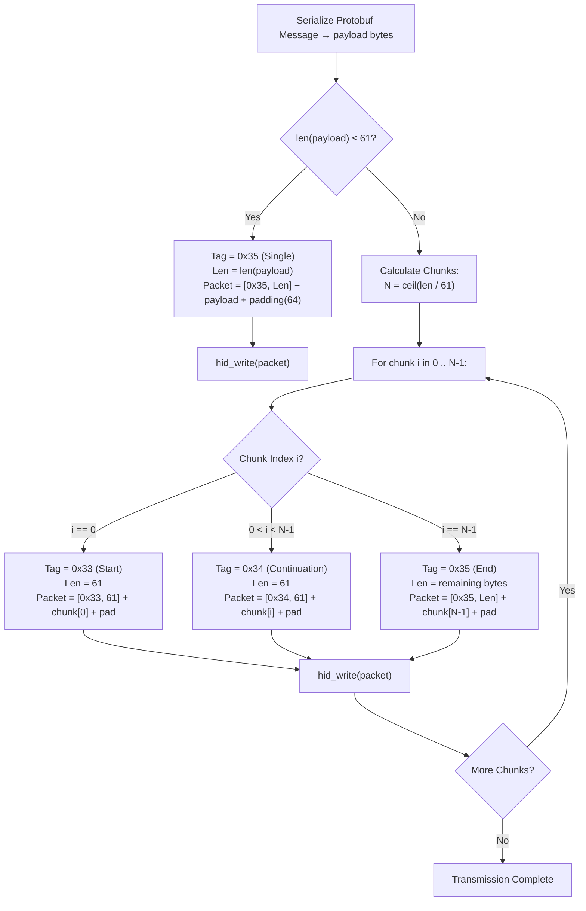
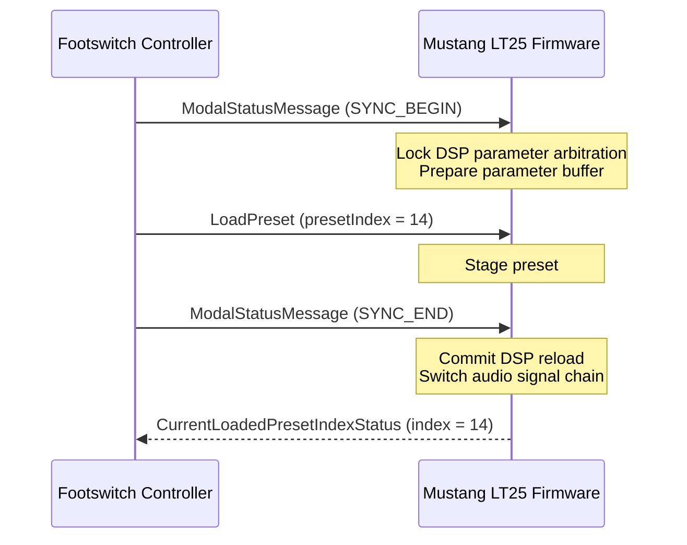

# Fender Mustang LT25 USB HID Protocol: Reverse Engineering & Technical Specification

The Fender Mustang LT25 digital modeling amplifier is officially controlled through the proprietary **Fender Tone** desktop software. The amplifier does not expose standard 5-pin DIN or USB-MIDI class endpoints. Instead, all preset management, chromatic tuner activation, DSP parameter tweaking, and real-time state telemetry occur over a proprietary **USB Human Interface Device (HID)** protocol transporting compiled **Google Protocol Buffers (Protobuf)** messages.

This document serves as the definitive reference manual for reverse-engineering, framing, and interfacing with the Fender Mustang LT25 DSP firmware.

---

## 1. USB Bus Enumeration & Endpoint Architecture

When the Mustang LT25 is connected to a host USB controller, it identifies itself as a standard Full-Speed USB HID composite peripheral.

### 1.1 USB Device Descriptor

```text
================================================================================
USB Device Descriptor: Fender Mustang LT25
================================================================================
  Vendor ID (VID):        0x1ED8 (Fender Musical Instruments)
  Product ID (PID):       0x0037 (Mustang LT25)
  Device Release:         v1.00
  Speed:                  Full-Speed (12 Mbps)
  Device Class:           0x00 (Defined at Interface level)
  Configuration Count:    1
--------------------------------------------------------------------------------
Configuration Descriptor 1:
  Interface 0:
    Interface Class:      0x03 (HID - Human Interface Device)
    Interface Subclass:   0x00 (None / No Boot Subclass)
    Protocol:             0x00 (None)
    Endpoints:
      - Endpoint 0x81 (EP1 IN):  Interrupt Transfer, 64 Bytes Max Packet Size, 1ms Polling
      - Endpoint 0x01 (EP1 OUT): Interrupt Transfer, 64 Bytes Max Packet Size, 1ms Polling
================================================================================
```

### 1.2 OS Driver Binding
* **Linux / Raspberry Pi OS:** The kernel automatically binds `hid-generic` creating `/dev/hidrawX`.
* **udev Permissions:** By default, `/dev/hidrawX` requires root privileges. A custom rule `/etc/udev/rules.d/99-fender-lt25.rules` grants user-space read/write access:
  ```udev
  SUBSYSTEM=="usb", ATTRS{idVendor}=="1ed8", ATTRS{idProduct}=="0037", MODE="0666"
  KERNEL=="hidraw*", ATTRS{idVendor}=="1ed8", ATTRS{idProduct}=="0037", MODE="0666"
  ```
* **hidapi Driver Backend:** User-space software communicates via `hidapi` (specifically `hid_write()` and `hid_read_timeout()`). Under `hidapi`, writes transmit a 65-byte buffer where Byte 0 is the Report ID (`0x00`), followed by 64 packet bytes. Raw OS reads return the 64-byte payload.

---

## 2. Multi-Packet Framing & Chunking Protocol

Protobuf messages vary widely in size—from a 3-byte `Heartbeat` to a 2,200-byte `CurrentPresetStatus` JSON payload. Because USB Full-Speed interrupt packets are strictly constrained to 64 bytes, Fender developed a lightweight chunking protocol.

### 2.1 Packet Header Structure

Every 64-byte HID interrupt packet conforms to the following layout:

```text
+--------------+---------------+-----------------------------------------------+
| Byte 0: TAG  | Byte 1: LEN   | Bytes 2..63: PAYLOAD DATA (Padded with 0x00)  |
+--------------+---------------+-----------------------------------------------+
  <--- 1 B --->   <--- 1 B --->   <------------------ 62 B ------------------->
```

* **Byte 0 (`TAG`):** Packet sequence framing identifier.
  * `0x33` (**START Chunk**): The first packet of a multi-packet transmission.
  * `0x34` (**CONTINUATION Chunk**): An intermediate payload packet.
  * `0x35` (**END / SINGLE Chunk**): The terminal packet of a multi-packet sequence, or the entire packet if payload $\le 61$ bytes.
* **Byte 1 (`LENGTH`):** Number of valid protobuf payload bytes contained in this packet ($1 \le \text{LEN} \le 61$).
* **Bytes 2 to $(2 + \text{LEN} - 1)$:** Raw serialized Protobuf byte stream.
* **Remaining Bytes:** Zero-padded (`0x00`) to guarantee an exact 64-byte interrupt transfer.

### 2.2 Packetization Flowchart



### 2.3 De-Packetization (Receiver State Machine)
When reading from the amplifier:
1. When a packet tagged `0x33` arrives: initialize a new byte accumulator with `packet[2 : 2 + LEN]`.
2. When a packet tagged `0x34` arrives: append `packet[2 : 2 + LEN]` to the accumulator.
3. When a packet tagged `0x35` arrives:
   * If an accumulator was active: append `packet[2 : 2 + LEN]` and dispatch the accumulated buffer to `FenderMessageLT.ParseFromString()`. Clear accumulator.
   * If no accumulator was active (single-packet message): parse `packet[2 : 2 + LEN]` immediately.

---

## 3. Protobuf Message Schema Catalog

The root envelope for all communication is the **`FenderMessageLT`** message.

### 3.1 Envelope Definition (`FenderMessageLT.proto`)

```protobuf
syntax = "proto2";
package ltamp;

enum ResponseType {
    UNSOLICITED = 0;
    NOT_LAST_ACK = 1;
    IS_LAST_ACK = 2;
}

message FenderMessageLT {
    optional ResponseType responseType = 1 [default = UNSOLICITED];
    
    // Commands & Parameter Injection
    optional LoadPreset loadPreset = 33;
    optional SetDspUnitParameter setDspUnitParameter = 34;
    optional ModalStatusMessage modalStatusMessage = 113;
    optional CurrentPresetRequest currentPresetRequest = 104;
    optional Heartbeat heartbeat = 201;
    optional QASlotsRequest qASlotsRequest = 108;
    optional QASlotsSet qASlotsSet = 116;
    optional FirmwareVersionRequest firmwareVersionRequest = 102;
    optional ConnectionStatusRequest connectionStatusRequest = 202;
    
    // Status & Telemetry Responses
    optional CurrentPresetStatus currentPresetStatus = 32;
    optional CurrentLoadedPresetIndexStatus currentLoadedPresetIndexStatus = 37;
    optional FirmwareVersionStatus firmwareVersionStatus = 103;
    optional QASlotsStatus qASlotsStatus = 109;
    optional ConnectionStatus connectionStatus = 203;
}
```

### 3.2 Modal Management: `ModalStatusMessage`

The LT25 uses modal states to lock UI operations and arbitrate DSP states:

```protobuf
enum ModalContext {
    SYNC_BEGIN            = 0;
    SYNC_END              = 1;
    BACKUP_BEGIN          = 2;
    BACKUP_END            = 3;
    RESTORE_BEGIN         = 4;
    RESTORE_END           = 5;
    TUNER_ENABLE          = 6;
    TUNER_DISABLE         = 7;
    FACTORY_RESTORE_BEGIN = 8;
    FACTORY_RESTORE_END   = 9;
    TONE_BUSY_BEGIN       = 10;
    TONE_BUSY_END         = 11;
}

enum ModalState {
    OK   = 0;
    FAIL = 1;
}

message ModalStatusMessage {
    required ModalContext context = 1;
    required ModalState state = 2 [default = OK];
}
```

### 3.3 Preset Selection: `LoadPreset`

```protobuf
message LoadPreset {
    required uint32 presetIndex = 1;  // 1 to 60 (Physical 1-indexed)
}
```

### 3.4 Real-Time DSP Manipulation: `SetDspUnitParameter`

```protobuf
message SetDspUnitParameter {
    required string nodeId = 1;            // e.g. "amp", "stomp", "mod", "delay", "reverb"
    required string parameterId = 2;       // e.g. "volume", "bypass", "gain", "tapTimeBPM"
    optional float floatParameter = 3;     // Volume (-60.0 to +12.0 dB), Gain (0.0 to 10.0), BPM (40 to 240)
    optional string stringParameter = 4;   // String parameter representation
    optional sint32 sint32Parameter = 5;   // Signed integer parameter
    optional bool boolParameter = 6;       // Bypass state (True = Bypassed, False = Active)
}
```

### 3.5 Preset Telemetry: `CurrentPresetStatus`

```protobuf
message CurrentPresetStatus {
    required string currentPresetData = 1;       // Serialized 2KB audioGraph JSON payload
    required uint32 currentSlotIndex = 2;        // Active slot index (1 to 60)
    optional bool currentPresetDirtyStatus = 3;  // True if preset has unsaved user edits
}
```

---

## 4. The Transactional Synchronization Rule

### 4.1 The Standalone Command Failure
One of the most perplexing challenges when reverse-engineering the Mustang LT25 is that **sending a standalone `LoadPreset` or `SetDspUnitParameter` packet is completely ignored by the amplifier DSP.**

If a host transmits:
```python
# FAILS SILENTLY!
amp.send_message(_msg(loadPreset=LoadPreset(presetIndex=4)))
```
The amp acknowledges the USB HID packet at the physical layer, but the preset never changes, and no audio changes occur.

### 4.2 The Mandatory Modal Handshake
The LT25 firmware employs an internal locking mechanism called **Modal Synchronization**. The amplifier DSP treats external parameter updates as atomic database transactions. To prevent race conditions between local front-panel rotary encoder changes and USB commands, the amplifier requires explicit transactional boundaries:

1. **Transaction Begin:** Transmit `ModalStatusMessage(context=SYNC_BEGIN, state=OK)`
2. **Execute Command:** Transmit `LoadPreset(slot)` or `SetDspUnitParameter(...)`
3. **Transaction Commit:** Transmit `ModalStatusMessage(context=SYNC_END, state=OK)`



**Latency Benchmark:** Over an active USB HID connection, executing `SYNC_BEGIN` $\to$ `LoadPreset` $\to$ `SYNC_END` executes in **under 1.2 milliseconds**, yielding immediate audio preset switching without stutter.

---

## 5. The Asymmetric Modal Tuner Protocol

The Mustang LT25 features an internal chromatic tuner that mutes the physical speaker / headphone output and displays a strobe tuning guide on the LCD screen.

Reversing the tuner control revealed a critical asymmetric behavioral rule:

### 5.1 Engaging Tuner Mode (`TUNER_ENABLE`)
* `TUNER_ENABLE` is a peer modal state.
* **Do NOT wrap `TUNER_ENABLE` in `SYNC_BEGIN` / `SYNC_END`!**
  * If wrapped in `SYNC_BEGIN` $\to$ `TUNER_ENABLE` $\to$ `SYNC_END`, the `SYNC_END` command instantly signals the firmware to terminate all active modal states, causing the tuner to flash on the screen for 2ms and immediately close.
* **Correct Implementation:** Send `TUNER_ENABLE` as a standalone unsolicited message:
  ```python
  amp.send_message(_msg(modalStatusMessage=ModalStatusMessage(
      context=ModalContext.TUNER_ENABLE, 
      state=ModalState.OK
  )))
  ```

### 5.2 Disengaging Tuner Mode (`TUNER_DISABLE`)
* Conversely, sending a standalone `TUNER_DISABLE` packet **fails**.
* If `TUNER_DISABLE` is sent alone, the LT25 firmware ignores the command and remains internally trapped in Tuner mode. The amplifier remains muted, and subsequent attempts to toggle the tuner or load presets fail.
* **The Transactional Requirement:** To successfully terminate the Tuner modal and unmute audio, `TUNER_DISABLE` **MUST** be explicitly wrapped inside a `SYNC` transaction:
  ```python
  amp.send_sync_begin()
  amp.send_message(_msg(modalStatusMessage=ModalStatusMessage(
      context=ModalContext.TUNER_DISABLE, 
      state=ModalState.OK
  )))
  amp.send_sync_end()
  ```

### 5.3 Fast Unmute Recovery
When unmuting from Tuner mode, the amplifier automatically restores the active preset audio graph within **47 milliseconds**.
* **Anti-Pattern Warning:** Do **NOT** send a redundant `LoadPreset` or `request_current_preset()` call immediately following `TUNER_DISABLE`. Doing so stalls the amplifier DSP command queue, introducing an 800ms audible gap.

---

## 6. DSP `audioGraph` Architecture & Parameter Injection

When the Mustang LT25 loads a preset, it constructs an internal `audioGraph` composed of interconnected signal processing blocks (nodes).

### 6.1 AudioGraph JSON Schema
Querying `CurrentPresetRequest` causes the amplifier to return a serialized JSON string representing the complete signal topology:

```json
{
  "name": "Silky Solo",
  "slotIndex": 2,
  "audioGraph": {
    "nodes": [
      {
        "nodeId": "stomp",
        "FenderId": "DUBS_Overdrive",
        "dspUnitParameters": {
          "bypass": false,
          "gain": 7.5,
          "tone": 6.0,
          "level": 8.0
        }
      },
      {
        "nodeId": "amp",
        "FenderId": "DUBS_Champ",
        "dspUnitParameters": {
          "volume": -10.5,
          "gain": 5.2,
          "bass": 6.0,
          "treble": 7.0
        }
      },
      {
        "nodeId": "delay",
        "FenderId": "DUBS_TapeDelay",
        "dspUnitParameters": {
          "bypass": true,
          "tapTimeBPM": 120.0,
          "feedback": 45.0,
          "mix": 35.0
        }
      },
      {
        "nodeId": "reverb",
        "FenderId": "DUBS_PlateReverb",
        "dspUnitParameters": {
          "bypass": false,
          "decay": 2.8,
          "mix": 25.0
        }
      }
    ]
  }
}
```

### 6.2 Solo Boost Implementation (+3.0 dB DSP Injection)
Rather than using an analog boost circuit or digital clipping overdrive, the controller performs a mathematical volume boost directly within the amplifier's digital signal processor:
1. When a preset is loaded, the controller reads and caches the `amp` node baseline volume:
   ```python
   base_vol = nodes_by_id["amp"]["dspUnitParameters"]["volume"]  # e.g. -10.5 dB
   ```
2. When the musician presses the active preset footswitch a second time, the controller toggles **Solo Boost**:
   ```python
   target_vol = base_vol + 3.0 if boost_active else base_vol
   
   amp.send_sync_begin()
   amp.send_message(_msg(setDspUnitParameter=SetDspUnitParameter(
       nodeId="amp",
       parameterId="volume",
       floatParameter=target_vol
   )))
   amp.send_sync_end()
   ```
3. **Dynamic Response:** The DSP adjusts amplifier output volume seamlessly within **15 milliseconds** with zero audible zipper noise or transient pops.

### 6.3 Stompbox FX Node Control
In **STOMP Mode**, the 5 lower footswitches directly manipulate the `bypass` boolean of individual DSP blocks:
* **Switch 1:** Overdrive / Distortion (`nodeId="stomp"`)
* **Switch 2:** Modulation (Chorus, Flanger, Phaser, Tremolo) (`nodeId="mod"`)
* **Switch 3:** Delay (`nodeId="delay"`)
* **Switch 4:** Delay Tap Tempo (`parameterId="tapTimeBPM"`)
* **Switch 5:** Reverb (`nodeId="reverb"`)

When a node contains `DUBS_Passthru`, that effect category is absent from the preset; the pedal recognizes this and dims the corresponding LED.

---

## 7. Asynchronous Streaming & Non-Blocking Design

### 7.1 The 2KB Streaming Bottleneck
When `CurrentPresetRequest` is sent, the amplifier responds with the complete JSON graph. Because the payload is ~2,200 bytes, it requires **36 consecutive 64-byte interrupt packets** over the USB bus:
$$36 \text{ packets} \times 1\text{ms to 24ms scheduling jitter} \approx \mathbf{850\text{ms}}$$

### 7.2 The Golden Decoupling Rule
If `request_current_preset()` were called synchronously within the main footswitch polling loop:
1. The musician stomps Switch 2.
2. The UI freezes for nearly a full second waiting for USB reception.
3. Rapid subsequent stomps or encoder turns are dropped.

**Architectural Solution:**
* **Instant Action on Press Down:** Footswitch press down executes `send_preset_to_amp()` (<1.2ms) and immediately updates the OLED display and WS2812B LEDs from local memory.
* **Decoupled Background Sync:** A daemon thread (`trigger_dsp_sync()`) queries `request_current_preset()` asynchronously in the background, updating internal node caches and base volume without blocking switch debouncing or stage rendering.

### 7.3 Suppression of Unsolicited HID Flooding
* Avoid running periodic 1-second `Heartbeat` loops while actively communicating.
* Avoid redundant polling of `ConnectionStatusRequest`.
* The LT25 automatically issues `CurrentLoadedPresetIndexStatus` upon receiving `LoadPreset`. Over-saturating the amplifier's micro-controller buffer leads to USB pipe stalls and dropped footswitch commands.
