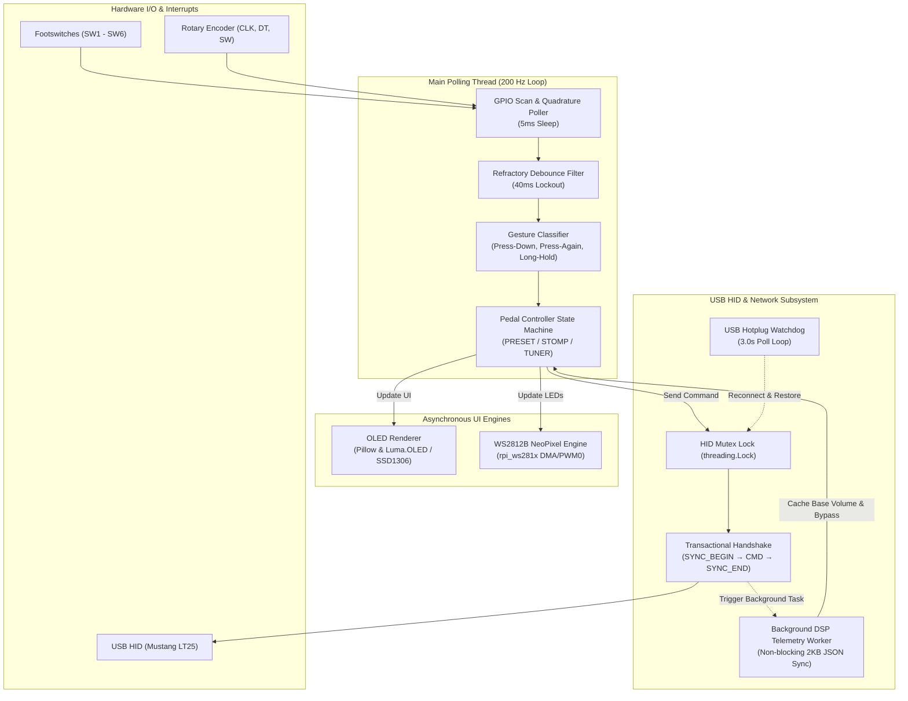
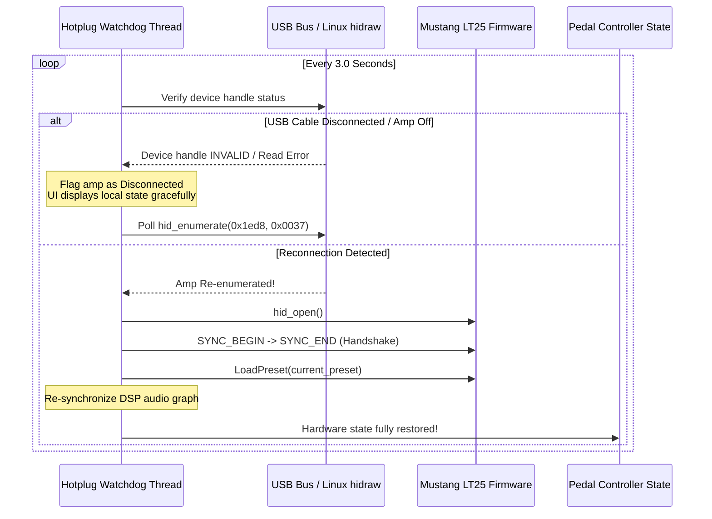

# Fender Mustang LT25 Smart Footswitch: Software Architecture & Daemon Manual

This document details the software architecture, multithreading model, state machines, debouncing algorithms, and UI rendering pipeline powering [`lt25_smart_pedal.py`](../lt25_smart_pedal.py).

---

## 1. System Architecture & Threading Model

The software runs as an autonomous, zero-latency Linux daemon ([`systemd/lt25-pedal.service`](../systemd/lt25-pedal.service)) on Raspberry Pi OS. It utilizes an event-driven, decoupled multithreaded architecture designed to guarantee **sub-millisecond footswitch response** regardless of heavy OLED frame rendering or USB HID streaming delays.

### 1.1 Concurrency & Data Flow Diagram



### 1.2 Thread Allocation Table

| Thread Identifier | Execution Context | Priority / Sleep | Role & Responsibilities |
| :--- | :--- | :--- | :--- |
| **Main Polling Thread** | Main Process | 5ms loop (200 Hz) | Non-blocking GPIO sampling, mechanical contact debouncing, encoder quadrature tracking, gesture evaluation. |
| **HID Watchdog Thread** | Daemon Thread | 3000ms loop | Monitors USB link integrity; automatically re-enumerates and synchronizes preset state if the USB cable is disconnected or the amp is power-cycled. |
| **Async DSP Sync Thread** | Daemon Thread (On-Demand) | Spawned on preset change | Streams 2KB audioGraph JSON over 36 USB interrupt chunks without stalling the UI; parses baseline volume and effect bypass flags. |
| **USB HID Reader Thread** | Background Thread | Event-driven (select) | Reads incoming 64-byte USB interrupt packets, reassembles chunks, and parses incoming Protobuf messages. |

---

## 2. Footswitch Event Handling & Mechanical Debouncing

Mechanical footswitches exhibit physical contact bounce lasting between 2ms and 25ms upon striking and releasing. Left unfiltered, a single stomp would trigger multiple preset changes or rapidly toggle Solo Boost on and off.

### 2.1 The 40ms Refractory Software Debounce Algorithm
Rather than introducing an artificial delay before triggering, the controller implements an **instant-strike refractory lockout**:

```text
Stomp Action:               [STOMP DOWN]                      [RELEASE]
Physical Contacts:          ||||||||||||                      |||||||||
                            |<-- 40ms Lockout -->|            |<-- 40ms Lockout -->|
Internal Logic State:       HIGH -> LOW                       LOW -> HIGH
Pedal Action:               TRIGGER ACTION IMMEDIATELY        RESET TIMERS
Perceived Latency:          < 0.1 ms (Zero Delay!)            —
```

1. **Instant Down-Action:** On the initial high-to-low transition, if the elapsed time since the switch was last released is $\ge 40\text{ms}$, the event is executed **immediately** on the leading edge. This delivers absolute zero perceived latency for the performer.
2. **Refractory Window:** A 40ms lockout timer is engaged. Any rapid voltage oscillations occurring during this window are discarded.
3. **Release Lockout:** When the contact opens (low-to-high transition), the system enforces a 40ms release lockout. If the button was held for longer than 40ms and not consumed by a long-press gesture, release actions (such as STOMP effect toggle) are dispatched.

### 2.2 Gesture State Machine

Each footswitch evaluates three distinct timing gestures:

```mermaid
stateDiagram-v2
    [*] --> Idle: Switch High (Resting)
    
    Idle --> StompDown: Pin LOW (Delta > 40ms)
    note right of StompDown: Zero-Latency Trigger:<br/>- Recall Preset<br/>- Toggle Solo Boost (if re-pressed)<br/>- Exit Tuner (Any-Key Exit)
    
    StompDown --> Held: Pin LOW & Duration >= Threshold
    note right of Held: Long-Press Gestures:<br/>- SW1 (>600ms): Bank Down<br/>- SW5 (>600ms): Bank Up<br/>- SW3 (>1000ms): Mode Toggle
    
    Held --> Release: Pin HIGH (Delta > 40ms)
    StompDown --> Release: Pin HIGH (Delta > 40ms)
    note right of Release: If NOT long-press:<br/>- STOMP mode toggles effect<br/>- TAP tempo interval calculated
    
    Release --> Idle
```

* **Instant Stomp (Down):** Recalls preset 1–5 within the active bank.
* **Press-Again (Down):** If the stomped preset is already the active preset, toggles **Solo Boost (+3.0 dB)**.
* **Bank Down (Hold SW1 > 600ms):** Decrements bank ($12 \rightarrow 1$), flashes LEDs Cyan, switches amp to Preset 1 of new bank.
* **Bank Up (Hold SW5 > 600ms):** Increments bank ($1 \rightarrow 12$), flashes LEDs Cyan, switches amp to Preset 1 of new bank.
* **Mode Toggle (Hold SW3 > 1000ms):** Swaps interface between **PRESET Bank Mode** and **STOMP FX Mode**.
* **Upper-Deck Switch 6 (Down):** Instantly toggles chromatic tuner and amplifier mute.
* **Any-Key Exit:** Stomping ANY footswitch (1 to 6) while the tuner is active immediately closes the tuner, restores audio output, and returns to the active preset without changing preset slots!

---

## 3. OLED Stage Display Architecture

The visual interface is driven by a 1.3-inch 128 $\times$ 64 high-contrast monochrome OLED display (SH1106 / SSD1306 controller via hardware I2C).

### 3.1 Screen Geometry & Layout Engine

To ensure readability from standing height on a dark, vibrating concert stage, the display avoids cluttered text menus and adopts a high-contrast split-screen layout:

```text
+-------------------------------------------------------------------+
|  [0..58px: COLOSSAL NUMBER]   | [61px] |  [65..127px: TITLE]      |
|                               |        |                          |
|         #####   #####         |   |    |    Fender                |
|        #     # #     #        |   |    |                          |
|        #     # #     #        |   |    |    Clean                 |
|        #     #  ######        |   |    |                          |
|        #     #       #        |   |    |    (Dynamic Size Fit)    |
|         #####   #####         |   |    |                          |
+-------------------------------------------------------------------+
```

#### 1. Colossal 64pt Preset Number Engine (X: 0 to 58)
* The preset number (`01` through `60`) is rendered in a massive 64pt bold TrueType font occupying the entire vertical height (64 pixels).
* **Centering Mathematics:** Using Pillow `draw.textbbox()`, the text bounding box is measured in sub-pixels and centered dynamically within the 58-pixel left column:
  $$nx = \frac{58 - \text{width}}{2} - \text{bbox}[0], \quad ny = \frac{64 - \text{height}}{2} - \text{bbox}[1]$$

#### 2. Sleek Vertical Divider (X: 61)
* A crisp 1-pixel vertical line extends from $Y=4$ to $Y=60$, physically separating numeric bank/preset telemetry from patch labeling.

#### 3. Dynamic Title Auto-Fit Engine (X: 65 to 127)
* Preset titles (up to 30 characters) are split across two clean rows.
* Words are partitioned evenly across lines.
* The engine evaluates the maximum character count of the split lines and selects the optimal font tier to prevent text clipping:
  * $\le 7$ characters: **16pt Large Header**
  * $8$ to $11$ characters: **13pt Medium Body**
  * $> 11$ characters: **9pt Micro Condensed**

### 3.2 Solo Boost High-Visibility Screen Inversion
When Solo Boost (+3.0 dB) is engaged, relying solely on small icons is insufficient under blinding stage lights. The renderer performs a full-frame buffer inversion:
```python
if is_boost and mode != "TUNER":
    image = ImageOps.invert(image.convert("L")).convert("1")
```
The entire screen flips from **white-on-black** to **radiant black-on-white**, giving the performer instant, unmistakable visual confirmation of boost status from across the stage.

### 3.3 Modal Screen Overlays

#### Chromatic Tuner / Amp Muted Screen:
```text
+-------------------------------------------------------------------+
|*********************** CHROMATIC TUNER ***************************|
|                                                                   |
|         +-----------------------------------------------+         |
|         |                  AMP MUTED                    |         |
|         +-----------------------------------------------+         |
|                                                                   |
|                      Tap any switch to exit                       |
+-------------------------------------------------------------------+
```

#### Stompbox FX Grid Mode:
```text
+-------------------------------------------------------------------+
|  [07]  |   +----+  +----+  +----+       +----+  +----+            |
|        |   | OD |  |MOD |  |DLY |       |TAP |  |REV |            |
|  Solo  |   +----+  +----+  +----+       +----+  +----+            |
|  Mid   |   (Active boxes inverted fill; Bypassed outline only)    |
+-------------------------------------------------------------------+
```

---

## 4. WS2812B NeoPixel Lighting Engine

The pedal incorporates 6 individually addressable WS2812B RGB LEDs mounted directly above the footswitches.

### 4.1 Color Telemetry Reference Matrix

| Color Name | RGB Value | Hex Code | Visual Meaning / Stage Telemetry |
| :--- | :---: | :---: | :--- |
| **Emerald Green** | `(0, 255, 60)` | `#00FF3C` | **Active Preset:** Indicates the currently active preset in Preset Mode. Also illuminates LED 6 when Tuner is engaged. |
| **Fiery Red** | `(255, 0, 0)` | `#FF0000` | **Solo Boost Engaged:** The active preset has +3.0 dB volume boost engaged on the DSP amp block. |
| **Amber Gold** | `(255, 120, 0)` | `#FF7800` | **FX Block Active:** In STOMP mode, signifies that the corresponding effects module (`stomp`, `mod`, `delay`, `reverb`) is active. |
| **Cyan Blue** | `(0, 150, 255)` | `#0096FF` | **Bank Navigation:** Double-flashes across all 6 LEDs during Bank Up / Bank Down navigation. |
| **Dim Standby** | `(15, 15, 15)` | `#0F0F0F` | **Inactive Stomp Slot:** Unselected presets and bypassed FX blocks glow dimly to outline switch locations in complete stage darkness without blinding the performer. |
| **Off** | `(0, 0, 0)` | `#000000` | **Disabled:** Upper-Deck Tuner LED is completely dark during normal performance. Lower LEDs extinguish during Tuner mute. |

---

## 5. Fault Tolerance & USB Hotplug Recovery

Live performance environments are prone to USB cable tugs, stage power glitches, and transient ground spikes. The software includes defensive recovery routines to ensure uninterrupted operation:



1. **Graceful Degradation:** If the USB cable is unplugged, footswitch inputs continue to update the OLED screen and LEDs locally; no unhandled Python exceptions crash the process.
2. **Auto-Reconnection:** The 3-second watchdog continuously scans the OS device tree via `hid.enumerate(0x1ed8, 0x0037)`. The instant the cable is reconnected, the driver rebinds, executes the mandatory initialization handshake, resends the active preset to the DSP, and restores synchronicity within 100ms.
